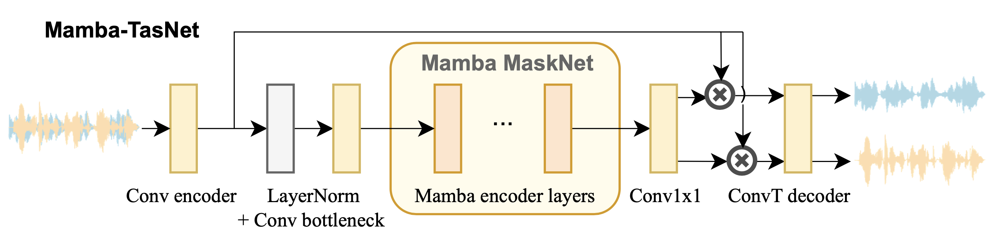
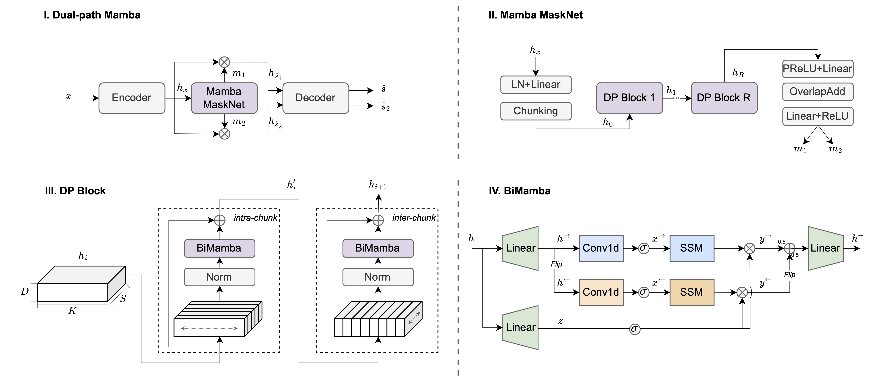
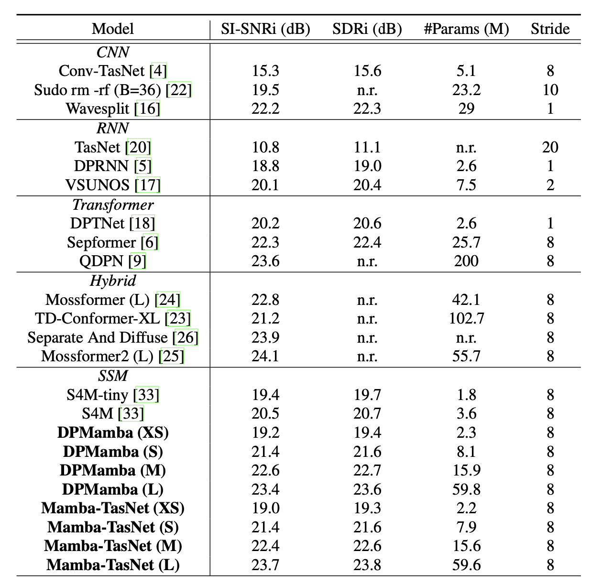

# Mamba-TasNet [](https://arxiv.org/abs/2407.09732) and Dual-Path Mamba [](https://arxiv.org/abs/2403.18257) 

An official implementation of Mamba-TasNet and dual-path Mamba for speech separation.

## Architectures




## Prerequisites

1. Download WSJ0 [corpus](https://catalog.ldc.upenn.edu/LDC93S6A) and follow an example [instruction](https://github.com/speechbrain/speechbrain/blob/develop/recipes/WSJ0Mix/separation/README.md) to create WSJ0-2Mix.

2. Install Packages.
```
conda create --name Slytherin python=3.9
conda activate Slytherin
pip install -r requirements.txt
```
You may need to install lower or higher versions of torch, torchaudio, causal-conv1d and mamba-ssm based on your hardware and system. Make sure they are compatible. 

## Training

```
python train_wsj0mix.py hparams/WSJ0Mix/{mambatasnet, dpmamba}_{XS, S, M, L}.yaml \
--data_folder </yourpath/wsj0-mix/2speakers> \
--dynamic_mixing True \
--base_folder_dm </yourpath/wsj0_processed/si_tr_s> \
--precision bf16
```

You might encounter numerical instablity in training L-sized model. 

We recommend training with fp32 if GPU memory permits.

Please check a related [issue](https://github.com/state-spaces/mamba/issues/6) and Section 6.4 in the Jamba [paper](https://arxiv.org/abs/2403.19887) on stabilizing loss.

## Masked JEPA with DualPath Mamba

`hparams/WSJ0Mix/dpmamba_S_jepa.yaml` keeps the original `dpmamba_S`
separator, data pipeline, optimizer, scheduling and checkpoint selection.
It adds a training-only masked source-prediction objective inspired by
[JEPAFormer](https://github.com/nautel/jepaformer/tree/85aef9049d12713d59756e242efd81284bcfdb1d).
The context encoder and predictor reuse this repository's Mamba blocks;
no JEPAFormer separator or training script is required.

```bash
python train_wsj0mix.py hparams/WSJ0Mix/dpmamba_S_jepa.yaml \
    --data_folder /path/to/wsj0-mix/2speakers \
    --dynamic_mixing True \
    --base_folder_dm /path/to/wsj0_processed/si_tr_s \
    --precision bf16
```

For already prepared static mixtures, use `--dynamic_mixing False` instead
of supplying `base_folder_dm`. Dataset preparation follows the original recipe.

The training loss is the existing PIT SI-SNR loss plus `jepa_weight` times
masked embedding MSE. Source latents are aligned using waveform PIT before
masking; targets come from frozen EMA copies of the encoder and context model.
Only valid, active, masked frames contribute. JEPA sequence models process
contiguous valid segments separately, so bidirectional scans cannot propagate
padding into valid embeddings. Artificially masked JEPA frames remain inside
these segments. The existing easy-example
threshold is still applied to SI-SNR, not to the combined loss. EMA updates
only after successful optimizer steps. Mask ratio/span, head sizes, loss
weight and EMA schedule are configured in YAML.

To resume, rerun the same command with the same YAML configuration and
`output_folder`. The existing SpeechBrain checkpointer restores the model,
optimizer and epoch counter; the additional `jepa` recoverable restores the
heads, target networks and EMA update count. The original epoch counter
chooses the next epoch; no `start_epoch` argument is needed. The `resume`
YAML option belongs to WandB and is not the checkpoint-resume switch.
A baseline checkpoint is not a full JEPA training checkpoint: use a separate
experiment folder for JEPA rather than mixing incompatible optimizer states.
The original recipe's scheduler reconstruction on resume is unchanged.

Validation, checkpoint selection and waveform inference use only the original
separation path. Original YAML files remain the baseline configurations.
`--jepa_weight 0` disables the auxiliary computation in the JEPA configuration;
use the original YAML to avoid allocating the extra modules altogether.

## LibriMix data (lab layout)

Use `hparams/LibriMix/dpmamba_S_jepa.yaml` for pre-generated clean LibriMix
mixtures. `data_folder` points to the `Libri2Mix` (or `Libri3Mix`) directory
containing `wav8k/min/train-100`, `wav8k/min/dev` and `wav8k/min/test`.
Each split contains `mix_clean`, `s1`, `s2` (and `s3` for three speakers).
This follows the data layout in the lab's Mamba-TasNet preparation code;
that external repository and the source audio are not modified.

```bash
python train_wsj0mix.py hparams/LibriMix/dpmamba_S_jepa.yaml \
    --data_folder /path/to/Libri2Mix \
    --precision bf16
```

`utils/prepare_librimix.py` validates source pairs, mono audio, sample rate
and matching lengths, then writes CSVs under the configured `save_folder`.
CSV names and paths are wired through YAML into the existing data loader.
Use `--librimix_train_split train-360`, `--sample_rate 16000`,
`--librimix_version max`, or `--num_spks 3` only with matching source data.
After CSVs are prepared, `--skip_prep True` reuses them.

Static mixtures use the existing `dynamic_mixing: False` branch. Dynamic
mixing is rejected for this LibriMix configuration because the upstream
mixer extracts WSJ-specific speaker IDs; it is not a LibriSpeech mixer.
Speed perturbation and all other training settings remain as in the WSJ
JEPA configuration. In particular, the upstream scheduler's fixed
`20000 // batch_size` step estimate is preserved, not recalibrated to
LibriMix dataset size. Resume the same LibriMix experiment by rerunning
its command; start a separate experiment when changing datasets.

The script retains its original `train_wsj0mix.py` name. YAML selects the
data preparation; the filename does not determine the dataset. Keep
`output_folder` and `save_folder` inside this workspace when running here.

## Inference and Checkpoints
You can download checkpoints from [Google drive](https://drive.google.com/drive/folders/1gHJJ0laJs7eZuHaeBjNBA5llTI99EzmS?usp=sharing) and put them in the ckpt folder.

See inference.ipynb for loading and running.

## Performance



## Acknowledgement

We acknowledge the wonderful work of [Mamba](https://arxiv.org/abs/2312.00752) and [Vision Mamba](https://arxiv.org/abs/2401.09417). We borrowed their implementation of [Mamba](https://github.com/state-spaces/mamba) and [bidirectional Mamba](https://github.com/hustvl/Vim). The training recipes are adapted from [SpeechBrain](https://speechbrain.github.io).

## Citation

If you find this work helpful, please consider citing:

```bibtex
@article{jiang2024speechslytherin,
      title={Speech Slytherin: Examining the Performance and Efficiency of Mamba for Speech Separation, Recognition, and Synthesis}, 
      author={Xilin Jiang and Yinghao Aaron Li and Adrian Nicolas Florea and Cong Han and Nima Mesgarani},
      year={2024},
      eprint={2407.09732},
      archivePrefix={arXiv},
      primaryClass={eess.AS},
      url={https://arxiv.org/abs/2407.09732}, 
}
```

```bibtex
@misc{jiang2024dual,
  title={Dual-path Mamba: Short and Long-term Bidirectional Selective Structured State Space Models for Speech Separation},
  author={Jiang, Xilin and Han, Cong and Mesgarani, Nima},
  journal={arXiv preprint arXiv:2403.18257},
  year={2024}
}
```

You may also like our Mamba for speech recognition : https://github.com/xi-j/Mamba-ASR
